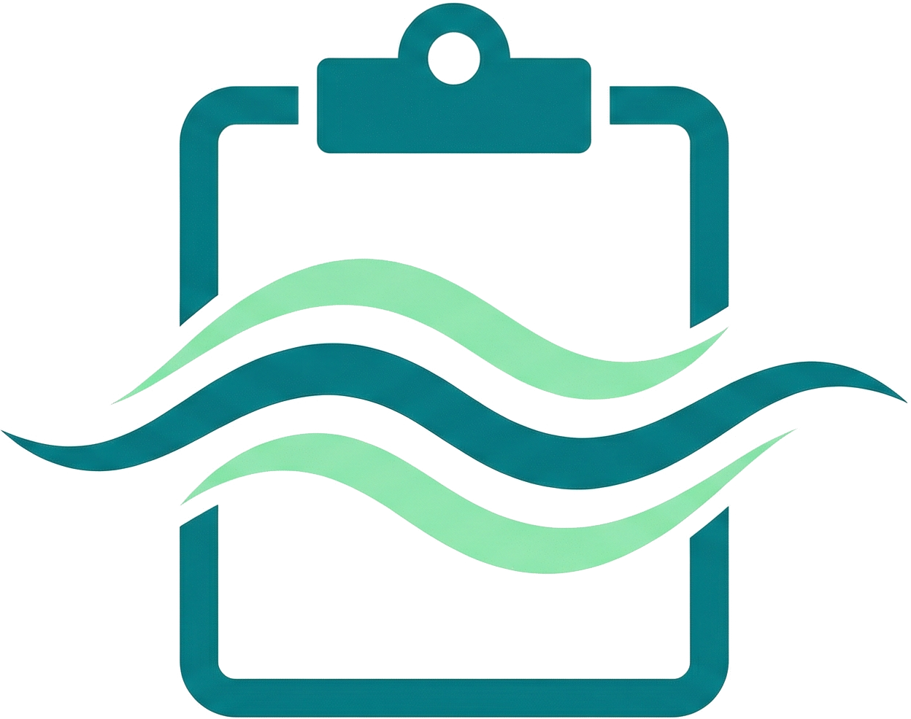

<p align="center">
  
</p>

<h1 align="center">Clipboard River</h1>

<p align="center">
  <a href="README.md">English</a> | <a href="README.zh-CN.md">简体中文</a>
</p>

<p align="center">
  A fast, low-friction clipboard sync system focused on making cross-device copy and paste feel almost invisible.
</p>

## Why Clipboard River

Clipboard River aims to make cross-device copy and paste feel familiar: copy on one device, switch devices, and paste.

- Fast: WebSocket delivers clipboard updates in realtime.
- Low-friction: clients can receive updates and write to the clipboard automatically, reducing manual sends and refreshes.
- Practical: text and single-file transfer, with image previews in the admin console.
- Controlled: self-hosting, history browsing, device permissions, and enrollment management.
- Cross-platform: Windows and Android clients are available; iOS is planned, and custom clients are welcome.

## Current Limitations

- The smoothest experience is between Windows clients while both devices are online.
- Each file upload accepts one file; multi-file and folder synchronization are not supported.
- Rich text, HTML fragments, and complex Office clipboard formats are not supported.
- Android restricts clipboard access and background operation, so its experience differs from Windows.
- WebSocket does not replay missed events. Clients can reconcile the latest 50 texts, which does not recover all offline history or missed file events.

## This Repository

This repository contains the server:

- device registration and enrollment
- realtime clipboard delivery
- clipboard history storage and a 50-item recent-text window
- file storage and downloads
- admin console
- Docker deployment and Windows/Linux binary releases

Clients and the server are separate projects. Clients may implement only the features they need, such as text uploads, realtime reception, or file transfer. See [ApiRef.md](./ApiRef.md) for the client protocol.

- Windows: [ClipboardRiverWindowsClient](https://github.com/CoronaAustralis/ClipboardRiverWindowsClient)
- Android: [ClipboardRiverAndroidClient](https://github.com/CoronaAustralis/ClipboardRiverAndroidClient)

## Quick Start

Download a binary package from [GitHub Releases](https://github.com/CoronaAustralis/ClipboardRiver/releases/latest). Go is not required.

| Platform | Package |
| --- | --- |
| Linux amd64 | `clipboard-river-server_linux_amd64.tar.gz` |
| Linux arm64 | `clipboard-river-server_linux_arm64.tar.gz` |
| Windows amd64 | `clipboard-river-server_windows_amd64.zip` |

Packages include the server, example config, and documentation. Archive checksums are in the release's `SHA256SUMS`.

Linux (amd64 example):

```bash
curl -fLO https://github.com/CoronaAustralis/ClipboardRiver/releases/latest/download/clipboard-river-server_linux_amd64.tar.gz
tar -xzf clipboard-river-server_linux_amd64.tar.gz
cd clipboard-river-server_linux_amd64
./clipboard-river-server --config ./config.json
```

Windows (PowerShell):

```powershell
Invoke-WebRequest -Uri "https://github.com/CoronaAustralis/ClipboardRiver/releases/latest/download/clipboard-river-server_windows_amd64.zip" -OutFile "clipboard-river-server_windows_amd64.zip"
Expand-Archive -Path .\clipboard-river-server_windows_amd64.zip -DestinationPath .
Set-Location .\clipboard-river-server_windows_amd64
.\clipboard-river-server.exe --config .\config.json
```

Find the initial admin password in the startup log and open [http://127.0.0.1:8080/admin/login](http://127.0.0.1:8080/admin/login). Enable enrollment in the console and register clients with the displayed code; the five-minute window allows unlimited registrations. Stop the server with `Ctrl+C`.

| Parameter | Purpose |
| --- | --- |
| `--config <path>` | Select the JSON config file; defaults to `./config.json` and creates it if missing |
| `--version` | Print version and exit |
| `--help` | Show help and exit |

## Server Configuration And Bootstrap

Server configuration is read only from JSON; see [config.example.json](./config.example.json). Edit options such as the listen address in the file and restart to apply them. Relative paths resolve from the process's working directory.

```json
{
  "server": { "listen_addr": ":8080" },
  "storage": {
    "driver": "sqlite",
    "dsn": "./data/clipboard_river.db",
    "data_dir": "./data",
    "blob_dir": "./data/blobs"
  },
  "auth": { "session_secret": "replace-with-a-long-random-secret" },
  "sync": {
    "default_retention_days": 30,
    "file_max_bytes": 5242880,
    "text_batch_limit": 200
  },
  "admin": { "username": "admin" }
}
```

Startup creates the default account and admin if needed. The generated 10-character admin password is logged once; only its hash is stored. A missing config is generated with a random `session_secret`. The example file is not loaded automatically.

- `file_max_bytes`: positive values limit bytes per file; `0` allows any size; `-1` rejects file uploads.
- `text_batch_limit`: maximum text items per batch; must be positive.
- `default_retention_days`: default retention for a new account; `0` keeps history indefinitely. Existing accounts can change retention and file limits in the console.

SQLite is the default; MySQL and PostgreSQL are also supported. Run one server process per database. Enrollment and the text window are held in memory: restart closes enrollment and rebuilds the text window from the database.

## Docker

Compose:

```bash
wget -O docker-compose.yml https://raw.githubusercontent.com/CoronaAustralis/ClipboardRiver/refs/heads/main/compose.yaml
docker compose up -d
```

Run directly on Linux:

```bash
docker run --name clipboard-river-server -p 8080:8080 -v "$(pwd)/data:/app/data" crestfallmax/clipboard-river-server:latest
```

For Windows PowerShell, use `-v "${PWD}\data:/app/data"`. The container loads `--config /app/data/config.json`; config, database, and files are persisted in the mounted `/app/data`. The initial admin password appears in container logs.

## Administration

The console provides history browsing, file downloads, device send/receive controls, soft deletion, temporary enrollment, retention, and file limits. Deleting a device revokes access while preserving its row and history links. Password changes require the current password and a new password of at least 8 characters.

## Build

Developers need Go 1.26 or later. Run these commands from the repository root.

Linux:

```bash
mkdir -p bin
./scripts/go-local.sh build -o ./bin/clipboard-river-server ./cmd/cb-river-server
./scripts/go-local.sh test ./...
```

Windows (PowerShell):

```powershell
New-Item -ItemType Directory -Force bin | Out-Null
powershell -ExecutionPolicy Bypass -File .\scripts\go-local.ps1 build -o .\bin\clipboard-river-server.exe ./cmd/cb-river-server
powershell -ExecutionPolicy Bypass -File .\scripts\go-local.ps1 test ./...
```

[go-local.sh](./scripts/go-local.sh) and [go-local.ps1](./scripts/go-local.ps1) use repository-local Go caches by default. Use `run` instead of `build` to run source directly, for example `./scripts/go-local.sh run ./cmd/cb-river-server --config ./config.json`.


If the Bash build script loses executable permissions, run `chmod +x scripts/go-local.sh`.
